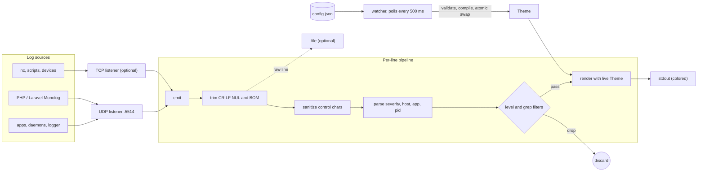
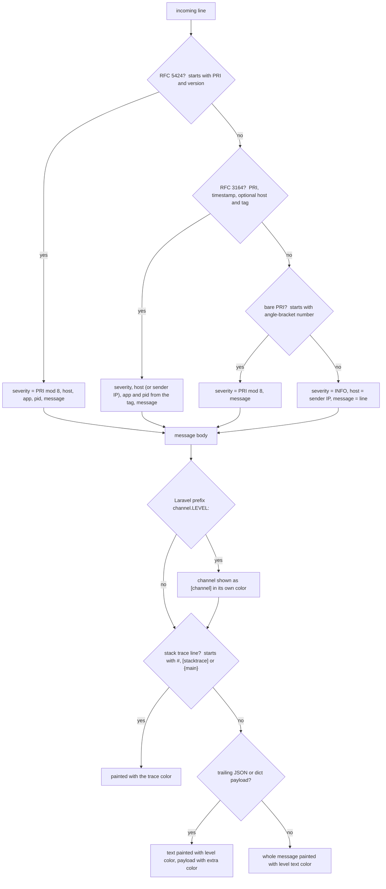
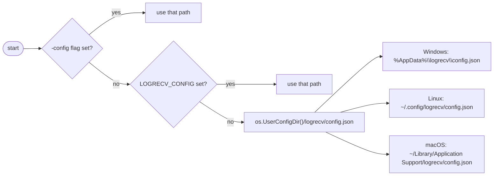
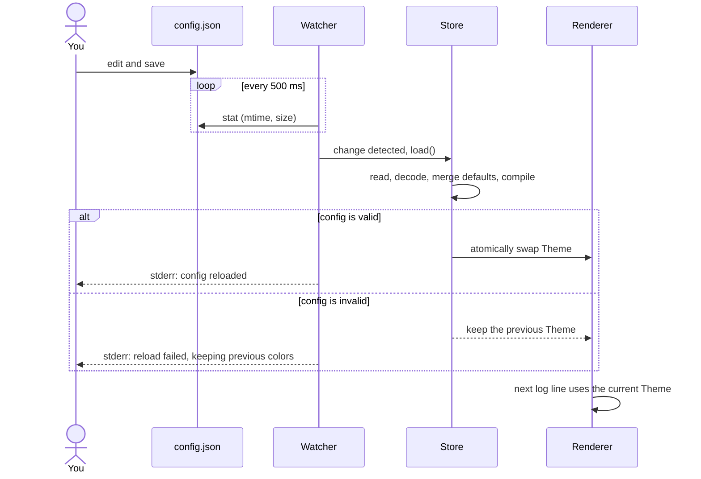
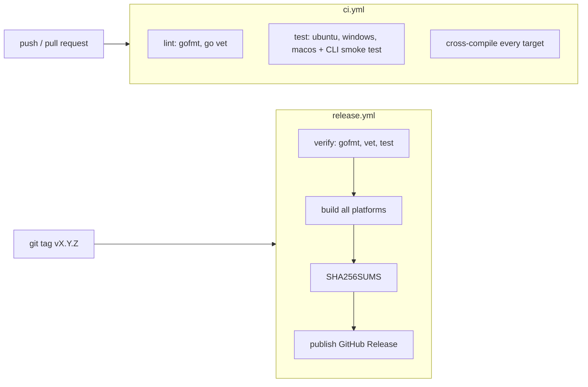

# logrecv-go

[](https://github.com/cumulus13/logrecv-go/actions/workflows/ci.yml)
[](https://github.com/cumulus13/logrecv-go/releases)
[](go.mod)
[](LICENSE)

A tiny, dependency-free **syslog / log receiver** for your terminal. It listens on UDP and/or TCP, understands
RFC 5424, RFC 3164 and plain lines (plus Laravel/Monolog-style `channel.LEVEL:` messages), and prints them as
colorful, aligned lines. Every color is a **hex code** you can change in a config file, and changes are applied
**live while it is running**.

- Single static binary, **zero third-party dependencies** (standard library only)
- UDP and TCP listeners, run either or both
- RFC 5424, RFC 3164, bare `<PRI>` and plain-text lines, Laravel/Monolog prefixes, JSON/dict payload highlighting
- Full **hex color** theming (`#RRGGBB` / `#RGB`), foreground and background, per level, per field
- **Hot reload**: edit the config while `logrecv` runs and colors change within ~0.5 s; a broken edit is ignored
- Truecolor with automatic fallback to 256 colors, respects `NO_COLOR` and disables colors when piped
- Safe output: control characters in incoming logs can't inject terminal escape sequences
- Level filter, text filter, and raw-line file tee
- Ready-made logging setups for **Laravel (Monolog), Python, Go and Rust**, see [Integrations](#integrations)
- Prebuilt binaries for Linux, Windows, macOS, the BSDs, Solaris/illumos, AIX and Plan 9

## Contents

- [How it works](#how-it-works)
- [Install](#install)
- [Quick start](#quick-start)
- [Usage](#usage)
- [Sending logs to it](#sending-logs-to-it)
- [Integrations: Laravel, Python, Go, Rust](#integrations)
- [Supported message formats](#supported-message-formats)
- [Colors and configuration](#colors-and-configuration)
- [Hot reload](#hot-reload)
- [Color modes](#color-modes)
- [Build from source](#build-from-source)
- [CI and releases](#ci-and-releases)
- [Supported platforms](#supported-platforms)
- [Troubleshooting](#troubleshooting)
- [License](#license)
- [Author](#-author)

## How it works



[](https://files.catbox.moe/3vc053.jpg)

## Install

### Prebuilt binaries

Download the archive for your platform from the [Releases](https://github.com/cumulus13/logrecv-go/releases)
page, verify it against `SHA256SUMS`, and put the `logrecv` binary somewhere on your `PATH`.

```sh
# Linux amd64 example
VERSION=v1.0.1
curl -LO https://github.com/cumulus13/logrecv-go/releases/download/$VERSION/logrecv_${VERSION}_linux_amd64.tar.gz
curl -LO https://github.com/cumulus13/logrecv-go/releases/download/$VERSION/SHA256SUMS
sha256sum --check --ignore-missing SHA256SUMS
tar xzf logrecv_${VERSION}_linux_amd64.tar.gz
sudo install logrecv_${VERSION}_linux_amd64/logrecv /usr/local/bin/
```

On Windows download the `.zip`, extract it, and run `logrecv.exe`.

> **macOS:** binaries are not notarized. If Gatekeeper blocks the download, run
> `xattr -d com.apple.quarantine ./logrecv` once.

### With Go

```sh
go install github.com/cumulus13/logrecv-go@latest
```

This installs a binary named `logrecv-go` (Go names it after the module). Rename or alias it to `logrecv` if you like.

## Quick start

```sh
logrecv init      # write the default config file (optional, defaults work without it)
logrecv show      # print effective config + a colored preview of every level
logrecv           # listen on UDP :5514 and print incoming logs
```

In another terminal:

```sh
logger -n 127.0.0.1 -P 5514 -d -p user.err -t myapp "something went wrong"
```

## Usage

```
logrecv [run] [flags]     start the receiver (default command)
logrecv init [-f]         write the default config file (-f overwrites)
logrecv show [-json]      show effective config and a color preview
logrecv path              print the config file path
logrecv version           print the version
logrecv help
```

### Run flags

| Flag | Default | Description |
|------|---------|-------------|
| `-udp ADDR` | `:5514` | UDP listen address. Empty string disables UDP. |
| `-tcp ADDR` | _(off)_ | TCP listen address, e.g. `:5514`. Lines are newline-delimited (max 1 MiB per line). |
| `-level LEVEL` | `debug` | Minimum level to show: `emerg`, `alert`, `crit`, `error` (`err`), `warn` (`warning`), `notice`, `info`, `debug`. |
| `-grep TEXT` | _(none)_ | Only show lines containing `TEXT` (case-insensitive). |
| `-file PATH` | _(none)_ | Also append the raw (uncolored) lines to `PATH`. |
| `-timefmt FMT` | `15:04:05.000` | [Go time layout](https://pkg.go.dev/time#pkg-constants) for the timestamp. |
| `-config PATH` | per-OS default | Config file to use. Also settable via `LOGRECV_CONFIG`. |
| `-color MODE` | `auto` | `auto`, `always`, `never` or `256`. See [Color modes](#color-modes). |

Informational messages (listening addresses, config reloads, warnings) go to **stderr**, so **stdout contains only
log lines** and is safe to pipe.

### Examples

```sh
logrecv -udp :514 -tcp :514                 # both transports on the standard syslog port (needs privileges)
logrecv -level warn                         # warnings and above only
logrecv -grep "payment" -file payments.log  # filter and keep a raw copy
logrecv -tcp :5514 -udp ""                  # TCP only
logrecv -color always | less -R             # keep colors when paging
```

## Sending logs to it

Anything that speaks syslog (RFC 5424 or RFC 3164) works. Quick tests from a shell:

```sh
# util-linux logger over UDP
logger -n 127.0.0.1 -P 5514 -d -p user.warning -t myapp "disk almost full"

# raw datagram with netcat (RFC 5424: <PRI>VERSION TIMESTAMP HOST APP PID MSGID SD MSG)
echo '<11>1 2026-10-28T10:00:00Z web01 nginx 4242 - - upstream failed {"code":502}' | nc -u -w1 127.0.0.1 5514

# TCP: one message per line
printf '<14>Oct 28 10:00:00 db01 postgres[7]: ready\n' | nc -w1 127.0.0.1 5514   # needs: logrecv -tcp :5514
```

```powershell
# PowerShell
$u = New-Object System.Net.Sockets.UdpClient
$b = [Text.Encoding]::UTF8.GetBytes('<11>1 2026-10-28T10:00:00Z win01 app 1 - - test message')
$u.Send($b, $b.Length, '127.0.0.1', 5514) | Out-Null
```

For application code, see [Integrations](#integrations) below. rsyslog can forward everything with
`*.* @127.0.0.1:5514` (UDP) or `*.* @@127.0.0.1:5514` (TCP).

## Integrations

Every example below sends to `127.0.0.1:5514` over **UDP** (the default). For TCP start the receiver with
`logrecv -tcp :5514` (UDP and TCP can use the same port number). Runnable copies of all the code live in
[`examples/`](examples/). Replace `127.0.0.1` with the machine running `logrecv` when your app runs elsewhere.

What you get on screen, whatever the language:

```
10:15:02.114  DEBUG  web01 my-app[240] cache miss {"key":"user:42"}
10:15:02.115  INFO   web01 my-app[240] user logged in {"name":"hadi"}
10:15:02.116  ERROR  web01 my-app[240] payment failed {"order":1234}
```

The colored parts are the timestamp, the level badge, the host, the app name, the pid and the trailing JSON.

### Laravel

Needs Laravel 10 or newer (Monolog 3). Laravel talks to `logrecv` through Monolog's `SyslogUdpHandler`, no package required.

**1. Add a channel** to `config/logging.php`
([`examples/laravel/logging-channel.php`](examples/laravel/logging-channel.php)):

```php
<?php
// config/logging.php  (Laravel 10+ / Monolog 3)

use Monolog\Formatter\LineFormatter;
use Monolog\Handler\SyslogUdpHandler;
use Monolog\Processor\PsrLogMessageProcessor;

return [
    // ...
    'channels' => [
        // ...
        'logrecv' => [
            'driver'  => 'monolog',
            'level'   => env('LOG_LEVEL', 'debug'),
            'handler' => SyslogUdpHandler::class,
            'handler_with' => [
                'host'  => env('LOGRECV_HOST', '127.0.0.1'),
                'port'  => (int) env('LOGRECV_PORT', 5514),
                'ident' => env('LOGRECV_IDENT', 'laravel'), // shown as the app name (no spaces)
            ],
            // Laravel's default formatter adds a "[date]" prefix; logrecv already shows the time.
            'formatter' => LineFormatter::class,
            'formatter_with' => [
                'format' => '%channel%.%level_name%: %message% %context% %extra%',
                'allowInlineLineBreaks' => true,
                'ignoreEmptyContextAndExtra' => true,
                'includeStacktraces' => true,
            ],
            'processors' => [PsrLogMessageProcessor::class],
        ],
    ],
];
```

**2. Turn it on** in `.env`, either on its own:

```env
LOG_CHANNEL=logrecv
```

or next to your normal log file (Laravel 11+; on older versions add `'logrecv'` to the `channels` array of the `stack` channel):

```env
LOG_CHANNEL=stack
LOG_STACK=single,logrecv
```

Optional settings:

```env
LOGRECV_HOST=127.0.0.1
LOGRECV_PORT=5514
LOGRECV_IDENT=my-laravel-app
```

**3. Log as usual**:

```php
use Illuminate\Support\Facades\Log;

Log::debug('query', ['sql' => 'select 1', 'ms' => 0.4]);
Log::info('user {name} logged in', ['name' => 'hadi']);
Log::warning('disk almost full', ['free_gb' => 1.2]);
Log::error('payment failed', ['order' => 1234]);

Log::channel('logrecv')->info('only sent to logrecv');   // when you use the stack

try {
    throw new RuntimeException('boom');
} catch (Throwable $e) {
    report($e);                                          // stack trace lines get the error colors
}
```

Notes:

- The `%channel%` part is your `APP_ENV` (for example `local`), shown as `[local]` in its own color.
- `formatter` is set on purpose: Laravel's default formatter prefixes every line with `[2026-10-28 10:15:02]`, which would
  repeat the time `logrecv` already shows. With the default formatter things still work, just noisier.
- `ident` becomes the app name column. Keep it free of spaces.
- Running in Docker or Sail? Point `LOGRECV_HOST` at the host: `host.docker.internal` (on Linux Docker add
  `--add-host=host.docker.internal:host-gateway` or use the `extra_hosts` entry in Compose).
- Each log line is its own UDP datagram, so a large stack trace can't blow past the datagram limit.

Without Laravel, the same thing with plain Monolog (`composer require monolog/monolog`):

```php
<?php
require __DIR__ . '/vendor/autoload.php';

use Monolog\Formatter\LineFormatter;
use Monolog\Handler\SyslogUdpHandler;
use Monolog\Logger;

$handler = new SyslogUdpHandler(host: '127.0.0.1', port: 5514, ident: 'my-php-app');
$handler->setFormatter(new LineFormatter(
    format: '%channel%.%level_name%: %message% %context% %extra%',
    allowInlineLineBreaks: true,
    ignoreEmptyContextAndExtra: true,
    includeStacktraces: true,
));

$log = new Logger('app', [$handler]);
$log->error('payment failed', ['order' => 1234]);
```

### Python

Standard library only. The three-line version
([`examples/python/simple.py`](examples/python/simple.py)):

```python
import logging
from logging.handlers import SysLogHandler

log = logging.getLogger("myapp")
log.setLevel(logging.DEBUG)
log.addHandler(SysLogHandler(address=("127.0.0.1", 5514)))

log.debug("cache miss")
log.info("user logged in")
log.warning("disk almost full")
log.error("payment failed")
log.critical("queue stalled")
```

That shows the level and message, with the sender's IP as the host. To also get **host, app name and pid** in their own
colors, give the handler a syslog-style format
([`examples/python/formatted.py`](examples/python/formatted.py)):

```python
import logging
import socket
from logging.handlers import SysLogHandler

HOST = socket.gethostname()

handler = SysLogHandler(address=("127.0.0.1", 5514), facility=SysLogHandler.LOG_USER)
# RFC 3164 style header so logrecv can show host, app name and pid in their own colors
handler.setFormatter(logging.Formatter(
    f"%(asctime)s {HOST} %(name)s[%(process)d]: %(message)s",
    datefmt="%b %d %H:%M:%S",
))

log = logging.getLogger("myapp")
log.setLevel(logging.DEBUG)
log.addHandler(handler)

log.info("user logged in")
log.error("payment failed")
try:
    1 / 0
except ZeroDivisionError:
    log.exception("boom")  # the traceback is shown with the same level/host/app
```

Multi-line messages such as tracebacks arrive as one datagram; every continuation line is shown with the same level, host,
app and pid as the first line, so a `log.exception(...)` stays red from top to bottom.

**`logging.config.dictConfig` and Django.** Use the same handler and formatter in your config
([`examples/python/dictconfig.py`](examples/python/dictconfig.py)). In Django, put the dict in `settings.py` as `LOGGING`:

```python
# Works the same in Django: put this dict in settings.py as LOGGING
# (and add "disable_existing_loggers": False).
import logging
import logging.config
import socket

LOGGING = {
    "version": 1,
    "disable_existing_loggers": False,
    "formatters": {
        "syslog": {
            "format": "%(asctime)s " + socket.gethostname() + " %(name)s[%(process)d]: %(message)s",
            "datefmt": "%b %d %H:%M:%S",
        },
    },
    "handlers": {
        "logrecv": {
            "class": "logging.handlers.SysLogHandler",
            "address": ("127.0.0.1", 5514),  # UDP
            "formatter": "syslog",
        },
    },
    "loggers": {
        "myapp": {"handlers": ["logrecv"], "level": "DEBUG"},
    },
}

logging.config.dictConfig(LOGGING)
logging.getLogger("myapp").warning("configured with dictConfig")
```

**TCP** instead of UDP, if you want delivery guarantees
([`examples/python/tcp.py`](examples/python/tcp.py), start `logrecv -tcp :5514`):

```python
import logging
import socket
from logging.handlers import SysLogHandler

# TCP instead of UDP: reliable delivery, same message format
handler = SysLogHandler(address=("127.0.0.1", 5514), socktype=socket.SOCK_STREAM)

log = logging.getLogger("myapp")
log.setLevel(logging.DEBUG)
log.addHandler(handler)

log.info("one")
log.error("two")
```

### Go

Two options.

**A) A `log/slog` handler (recommended).** Portable (it also works on Windows), standard library only, and structured
attributes are sent as the trailing JSON that `logrecv` highlights. Copy the handler from
[`examples/go/slog/main.go`](examples/go/slog/main.go) (it is below) and use it like this:

```go
h, err := NewSyslogHandler("udp", "127.0.0.1:5514", "my-go-app", slog.LevelDebug)
if err != nil {
	panic(err)
}
defer h.Close()
log := slog.New(h)

log.Debug("cache miss", "key", "user:42")
log.Info("user logged in", "name", "hadi", slog.Group("req", "ip", "10.0.0.5", "ms", 12))
log.Warn("disk almost full", "free_gb", 1.2)
log.With("order", 1234).Error("payment failed", "err", errors.New("card declined"))
```

Use `"tcp"` as the first argument to send over TCP. slog levels map to syslog severities: Error is `ERROR`, Warn is
`WARN`, Info is `INFO`, Debug is `DEBUG`.

<details>
<summary>Full handler code (<code>examples/go/slog/main.go</code>)</summary>

```go
package main

import (
	"context"
	"encoding/json"
	"errors"
	"fmt"
	"log/slog"
	"net"
	"os"
	"sync"
	"time"
)

// SyslogHandler is a slog.Handler that ships RFC 5424 messages to logrecv.
// Standard library only, works on every OS (including Windows).
type SyslogHandler struct {
	mu     *sync.Mutex
	conn   net.Conn
	nl     string // "\n" for TCP framing, "" for UDP
	host   string
	app    string
	level  slog.Leveler
	attrs  []slog.Attr
	prefix string // dotted group path
}

// NewSyslogHandler dials network ("udp" or "tcp") and address, e.g. "127.0.0.1:5514".
func NewSyslogHandler(network, addr, app string, level slog.Leveler) (*SyslogHandler, error) {
	conn, err := net.Dial(network, addr)
	if err != nil {
		return nil, err
	}
	host, _ := os.Hostname()
	if host == "" {
		host = "-"
	}
	nl := ""
	if network == "tcp" {
		nl = "\n"
	}
	return &SyslogHandler{mu: &sync.Mutex{}, conn: conn, nl: nl, host: host, app: app, level: level}, nil
}

func (h *SyslogHandler) Close() error { return h.conn.Close() }

func (h *SyslogHandler) Enabled(_ context.Context, l slog.Level) bool {
	return l >= h.level.Level()
}

func severity(l slog.Level) int {
	switch {
	case l >= slog.LevelError:
		return 3 // error
	case l >= slog.LevelWarn:
		return 4 // warning
	case l >= slog.LevelInfo:
		return 6 // info
	default:
		return 7 // debug
	}
}

func flatten(dst map[string]any, prefix string, a slog.Attr) {
	v := a.Value.Resolve()
	if v.Kind() == slog.KindGroup {
		p := prefix
		if a.Key != "" {
			p += a.Key + "."
		}
		for _, ga := range v.Group() {
			flatten(dst, p, ga)
		}
		return
	}
	if a.Key == "" {
		return
	}
	switch x := v.Any().(type) {
	case error:
		dst[prefix+a.Key] = x.Error()
	default:
		dst[prefix+a.Key] = x
	}
}

func (h *SyslogHandler) Handle(_ context.Context, r slog.Record) error {
	fields := map[string]any{}
	for _, a := range h.attrs {
		flatten(fields, "", a)
	}
	r.Attrs(func(a slog.Attr) bool {
		flatten(fields, h.prefix, a)
		return true
	})
	msg := r.Message
	if len(fields) > 0 {
		if b, err := json.Marshal(fields); err == nil {
			msg += " " + string(b)
		}
	}
	const facilityUser = 1
	line := fmt.Sprintf("<%d>1 %s %s %s %d - - %s%s",
		facilityUser*8+severity(r.Level), r.Time.Format(time.RFC3339Nano), h.host, h.app, os.Getpid(), msg, h.nl)
	h.mu.Lock()
	defer h.mu.Unlock()
	_, err := h.conn.Write([]byte(line))
	return err
}

func (h *SyslogHandler) WithAttrs(attrs []slog.Attr) slog.Handler {
	c := *h
	for _, a := range attrs {
		if h.prefix != "" {
			a = slog.Group(h.prefix[:len(h.prefix)-1], a)
		}
		c.attrs = append(append([]slog.Attr(nil), c.attrs...), a)
	}
	return &c
}

func (h *SyslogHandler) WithGroup(name string) slog.Handler {
	if name == "" {
		return h
	}
	c := *h
	c.prefix += name + "."
	return &c
}

func main() {
	h, err := NewSyslogHandler("udp", "127.0.0.1:5514", "my-go-app", slog.LevelDebug)
	if err != nil {
		panic(err)
	}
	defer h.Close()
	log := slog.New(h)

	log.Debug("cache miss", "key", "user:42")
	log.Info("user logged in", "name", "hadi", slog.Group("req", "ip", "10.0.0.5", "ms", 12))
	log.Warn("disk almost full", "free_gb", 1.2)
	log.With("order", 1234).Error("payment failed", "err", errors.New("card declined"))
}
```

</details>

**B) The standard library `log/syslog`.** Unix only (it does not exist on Windows or Plan 9). Short and needs no extra code
([`examples/go/stdsyslog/main.go`](examples/go/stdsyslog/main.go)):

```go
//go:build !windows && !plan9

package main

import (
	"log"
	"log/syslog"
)

func main() {
	w, err := syslog.Dial("udp", "127.0.0.1:5514", syslog.LOG_USER|syslog.LOG_DEBUG, "my-go-app")
	if err != nil {
		log.Fatal(err)
	}
	defer w.Close()

	w.Debug("cache miss")
	w.Info("user logged in")
	w.Warning("disk almost full")
	w.Err("payment failed")
	w.Crit("queue stalled")
}
```

### Rust

Tested with Rust 1.91.

**A) The `syslog` crate with the `log` facade.** Add to `Cargo.toml`:

```toml
[dependencies]
syslog = "7"
log = "0.4"
```

([`examples/rust/src/bin/syslog_crate.rs`](examples/rust/src/bin/syslog_crate.rs)):

```rust
use log::{debug, error, info, warn, LevelFilter};
use syslog::{BasicLogger, Facility, Formatter3164};

fn main() {
    let formatter = Formatter3164 {
        facility: Facility::LOG_USER,
        hostname: None, // detected automatically
        process: "my-rust-app".into(),
        pid: std::process::id(),
    };

    // local socket on any port, logrecv on 127.0.0.1:5514
    let logger = syslog::udp(formatter, "0.0.0.0:0", "127.0.0.1:5514").expect("cannot connect to logrecv");

    log::set_boxed_logger(Box::new(BasicLogger::new(logger)))
        .map(|()| log::set_max_level(LevelFilter::Debug))
        .expect("logger already set");

    debug!("cache miss key={}", "user:42");
    info!("user logged in name={}", "hadi");
    warn!("disk almost full free_gb={}", 1.2);
    error!("payment failed order={}", 1234);
}
```

**B) Standard library only**: a tiny RFC 5424 sender over UDP
([`examples/rust/src/bin/std_udp.rs`](examples/rust/src/bin/std_udp.rs)). Append structured data as JSON at the end of the
message and `logrecv` will highlight it:

```rust
use std::net::UdpSocket;
use std::process;

// Minimal RFC 5424 sender: standard library only.
struct LogRecv {
    sock: UdpSocket,
    host: String,
    app: &'static str,
}

#[derive(Clone, Copy)]
enum Level {
    Error = 3,
    Warning = 4,
    Info = 6,
    Debug = 7,
}

impl LogRecv {
    fn new(addr: &str, app: &'static str) -> std::io::Result<Self> {
        let sock = UdpSocket::bind("0.0.0.0:0")?;
        sock.connect(addr)?;
        let host = std::env::var("HOSTNAME")
            .or_else(|_| std::env::var("COMPUTERNAME"))
            .unwrap_or_else(|_| "-".into());
        Ok(Self { sock, host, app })
    }

    fn log(&self, level: Level, msg: &str) {
        // <PRI>1 TIMESTAMP HOST APP PID MSGID SD MSG  (timestamp "-" = unknown; logrecv shows its own clock)
        let line = format!("<{}>1 - {} {} {} - - {}", 8 + level as u8, self.host, self.app, process::id(), msg);
        let _ = self.sock.send(line.as_bytes()); // UDP: fire and forget
    }
}

fn main() -> std::io::Result<()> {
    let log = LogRecv::new("127.0.0.1:5514", "my-rust-app")?;
    log.log(Level::Debug, "cache miss {\"key\":\"user:42\"}");
    log.log(Level::Info, "user logged in {\"name\":\"hadi\"}");
    log.log(Level::Warning, "disk almost full {\"free_gb\":1.2}");
    log.log(Level::Error, "payment failed {\"order\":1234}");
    Ok(())
}
```

Run the examples with `cargo run --bin syslog_crate` or `cargo run --bin std_udp` from `examples/rust/`.

### Anything else

If your language or tool can write a UDP datagram, it can log here. The smallest useful message is
`<PRI>text`, where `PRI` is `facility * 8 + severity` (for example `<11>` is user facility, severity 3 = error). The
[supported formats](#supported-message-formats) section lists everything that is understood.

## Supported message formats

Each incoming line is matched in this order; the first match wins.



[](https://files.catbox.moe/cb68vc.jpg)

Notes:

- Severity is taken from the low 3 bits of the syslog `<PRI>` value (the facility is ignored).
- RFC 3164 is accepted with the classic `Oct 28 10:00:00` timestamp or an RFC 3339 one (Go's `log/syslog`), with or
  without a hostname (Rust's `syslog` crate omits it; the sender's IP is shown instead), and with an optional space after `<PRI>`.
- Multi-line UDP datagrams are split on `\n`. A line that has no `<PRI>` of its own (a traceback, for instance) inherits the
  level, host, app and pid of the line before it, in the same datagram or TCP connection.
- TCP messages end at a newline or at a NUL byte, so Python's `SysLogHandler` works as it is.
- Trailing `\r`, `\n`, NUL bytes and a leading BOM are stripped.

| Severity | Label shown | Config key |
|---------:|-------------|------------|
| 0 | `EMERG` | `emergency` |
| 1 | `ALERT` | `alert` |
| 2 | `CRIT` | `critical` |
| 3 | `ERROR` | `error` |
| 4 | `WARN` | `warning` |
| 5 | `NOTICE` | `notice` |
| 6 | `INFO` | `info` |
| 7 | `DEBUG` | `debug` |

## Colors and configuration

### Where the config lives



[](https://files.catbox.moe/55sbnz.jpg)

Run `logrecv path` to print the exact path on your machine. A missing or empty file simply means "use the defaults".

### Config format

`config.json` is plain JSON (no comments). Any key you leave out keeps its default. Unknown keys are rejected so typos
are caught. Colors are `#RRGGBB` or `#RGB` (`#` optional).

```json
{
  "datetime": "#00AAFF",
  "host":     "#FFFFFF",
  "app":      "#00AA00",
  "pid":      "#E8E8E8",
  "channel":  "#FFFFFF",
  "extra":    "#FFFFFF",
  "trace":    "#FFFFFF",
  "levels": {
    "emergency": { "level": { "fg": "#FFFFFF", "bg": "#AA00FF" }, "text": { "fg": "#FFFFFF", "bg": "#AA00FF" } },
    "alert":     { "level": { "fg": "#FFFFFF", "bg": "#0000FF" }, "text": { "fg": "#FFFFFF", "bg": "#0000FF" } },
    "critical":  { "level": { "fg": "#FFFFFF", "bg": "#005500" }, "text": { "fg": "#FFFFFF", "bg": "#005500" } },
    "error":     { "level": { "fg": "#FFFFFF", "bg": "#FF0000" }, "text": { "fg": "#FFFFFF", "bg": "#FF0000" } },
    "warning":   { "level": { "fg": "#000000", "bg": "#FFFF00" }, "text": { "fg": "#000000", "bg": "#FFFF00" } },
    "notice":    { "level": { "fg": "#000000", "bg": "#00FFFF" }, "text": { "fg": "#00FFFF" } },
    "info":      { "level": { "fg": "#000000", "bg": "#00FF00" }, "text": { "fg": "#00FF00" } },
    "debug":     { "level": { "fg": "#FFFFFF", "bg": "#FF5500" }, "text": { "fg": "#FFFFFF", "bg": "#FF5500" } }
  }
}
```

### What each key colors

| Key | Applies to |
|-----|------------|
| `datetime` | the timestamp |
| `host` | the sender host name or IP |
| `app` | the application / program name |
| `pid` | the process id, shown as `[1234]` |
| `channel` | the Laravel/Monolog channel prefix, shown as `[local]` |
| `extra` | trailing JSON / dict payload at the end of a message |
| `trace` | stack-trace lines (`#0 ...`, `[stacktrace]`, `{main}`) |
| `levels.<name>.level` | the level badge (e.g. ` ERROR `) |
| `levels.<name>.text` | the message text of that level |

For each `level` / `text` object, `fg` is the foreground and `bg` the background (either may be omitted). When you
override a `level` or `text` object it replaces the default object entirely, so include every field you want.

### Default palette

| Level | Badge (fg on bg) | Message (fg on bg) |
|-------|------------------|--------------------|
| EMERGENCY | `#FFFFFF` on `#AA00FF` | `#FFFFFF` on `#AA00FF` |
| ALERT | `#FFFFFF` on `#0000FF` | `#FFFFFF` on `#0000FF` |
| CRITICAL | `#FFFFFF` on `#005500` | `#FFFFFF` on `#005500` |
| ERROR | `#FFFFFF` on `#FF0000` | `#FFFFFF` on `#FF0000` |
| WARNING | `#000000` on `#FFFF00` | `#000000` on `#FFFF00` |
| NOTICE | `#000000` on `#00FFFF` | `#00FFFF` |
| INFO | `#000000` on `#00FF00` | `#00FF00` |
| DEBUG | `#FFFFFF` on `#FF5500` | `#FFFFFF` on `#FF5500` |

Datetime is `#00AAFF`, app is `#00AA00`, pid is `#E8E8E8`, and JSON/dict payloads, hosts, channels and traces are `#FFFFFF`.

### Config commands

```sh
logrecv init          # create the config with the defaults (refuses to overwrite)
logrecv init -f       # overwrite an existing config
logrecv path          # print the config path
logrecv show          # path, effective config and a colored preview of all levels
logrecv show -json    # only the effective config as JSON (good for scripts)
```

## Hot reload

The running receiver watches the config file. Save a change and the new colors apply to the very next line, no
restart needed. If the edit is invalid (bad hex, unknown key, broken JSON) the previous colors stay active and a
warning is printed to stderr. Deleting the file switches back to the defaults.



[](https://files.catbox.moe/uvt0gx.jpg)

The file is polled rather than watched with OS notifications, which keeps the program dependency-free and behaving
the same on every platform.

## Color modes

`-color auto` (the default) picks the best mode for your terminal:


[](https://files.catbox.moe/frfbth.jpg)

Force a mode with `-color always` (truecolor), `-color 256` or `-color never`. Use `always` when you want colors in
a pipe, or in terminals such as Git Bash/mintty that don't look like a console to Go.

## Build from source

Requires Go 1.25 or newer.

```sh
git clone https://github.com/cumulus13/logrecv-go
cd logrecv-go
go build -trimpath -ldflags "-s -w -X main.version=1.0.1" -o logrecv .
go test ./...
```

Cross-compile every release target with the same script CI uses:

```sh
bash .github/scripts/build-release.sh v1.0.1 dist
```

Project layout:

```
main.go                entry point, commands, listeners, log parsing and rendering
config.go              config schema, defaults, loading, theme compilation, hot-reload store
color.go               hex parsing, truecolor/256 ANSI, color mode detection
console_windows.go     enables ANSI/VT processing on the Windows console
console_other.go       no-op for other platforms
main_test.go           unit tests
examples/              tested logging examples: laravel/, python/, go/, rust/
.github/targets.txt    release platform list
.github/scripts/       release build script
.github/workflows/     CI and release pipelines
```

## CI and releases



[](https://files.catbox.moe/k1thtb.jpg)

To cut a release:

```sh
git tag v1.0.2
git push origin v1.0.2
```

Tags that contain a hyphen (for example `v1.1.0-rc.1`) are published as pre-releases.

## Supported platforms

Release archives are produced for these targets (static binaries, `CGO_ENABLED=0`). Windows builds are `.zip`,
everything else `.tar.gz`.

| OS | Architectures |
|----|---------------|
| Linux | amd64, 386, arm64, armv6, armv7, riscv64, loong64, ppc64, ppc64le, s390x, mips / mipsle / mips64 / mips64le (hardfloat and softfloat) |
| Windows | amd64, 386, arm64 |
| macOS | amd64 (Intel), arm64 (Apple Silicon) |
| FreeBSD | amd64, 386, arm64, armv7 |
| OpenBSD | amd64, 386, arm64, armv7, ppc64, riscv64 |
| NetBSD | amd64, 386, arm64, armv7 |
| DragonFly BSD | amd64 |
| Solaris / illumos | amd64 |
| AIX | ppc64 |
| Plan 9 | 386, amd64, arm |

## Troubleshooting

- **`udp: listen ... address already in use`**: another process uses that port. Pick another with `-udp :5515`, or stop the other one.
- **Ports below 1024 (e.g. 514) fail with a permission error**: run with sufficient privileges or use a high port and point your senders at it.
- **No colors in a pipe or in Git Bash**: this is intentional in `auto` mode; use `-color always`.
- **Colors look wrong or washed out**: your terminal may not support truecolor. Try `-color 256`.
- **Some colors look different from the config (for example white text on red or orange turns dark)**: `logrecv` sends the exact
  24-bit colors you configured; the terminal is changing them. Windows Terminal's "Automatically adjust lightness of
  indistinguishable text" (`adjustIndistinguishableColors`) and VS Code's `terminal.integrated.minimumContrastRatio` darken or
  lighten any foreground whose contrast against its background is too low (white on `#FF0000` is about 4:1). Set
  `"adjustIndistinguishableColors": "never"` in your Windows Terminal profile (or `"terminal.integrated.minimumContrastRatio": 1`
  in VS Code) to show the colors exactly. To confirm what is being sent, run `logrecv show` in a terminal without such a feature.
- **Config edits don't seem to apply**: check stderr for `config reload failed`; run `logrecv show` to see the exact error.
- **Windows console shows escape codes literally**: use Windows Terminal or Windows 10+ console; `logrecv` enables VT processing automatically.
- **Nothing shows up**: check the sender's target port/protocol, any `-level` / `-grep` filter, and your firewall (UDP is silent when dropped).

## License

[MIT](LICENSE) © Hadi Cahyadi

## 👤 Author
        
[Hadi Cahyadi](mailto:cumulus13@gmail.com)
    

[](https://www.buymeacoffee.com/cumulus13)

[](https://ko-fi.com/cumulus13)
 
[Support me on Patreon](https://www.patreon.com/cumulus13)
