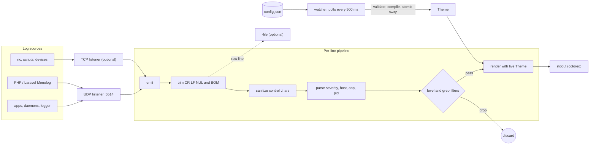
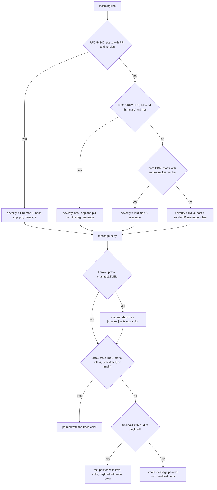
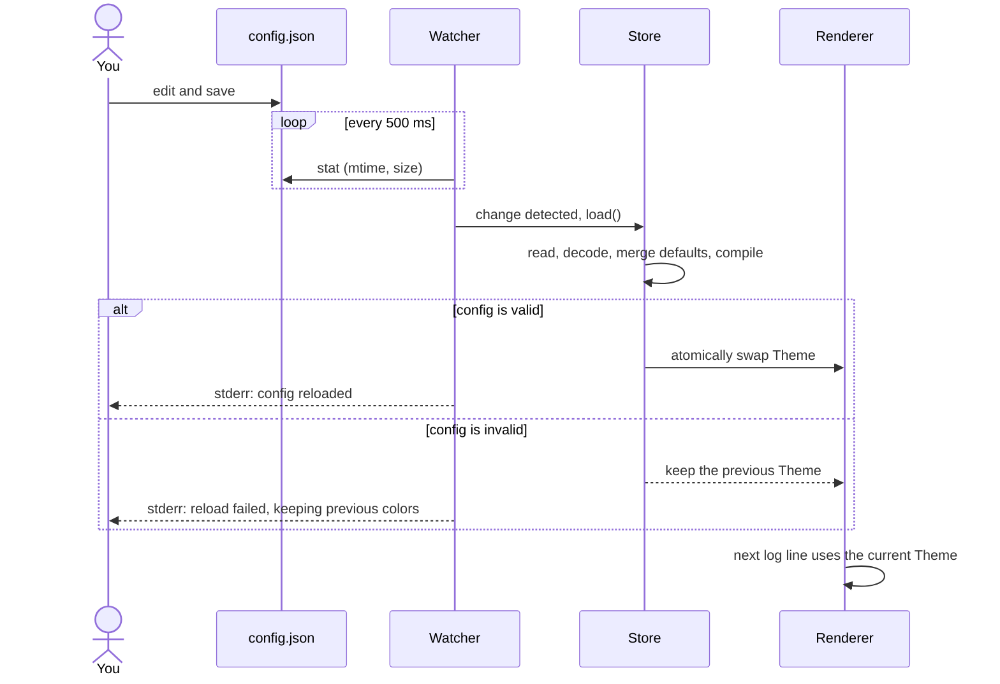
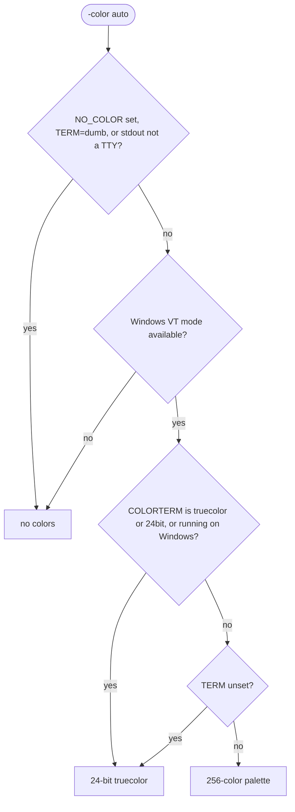
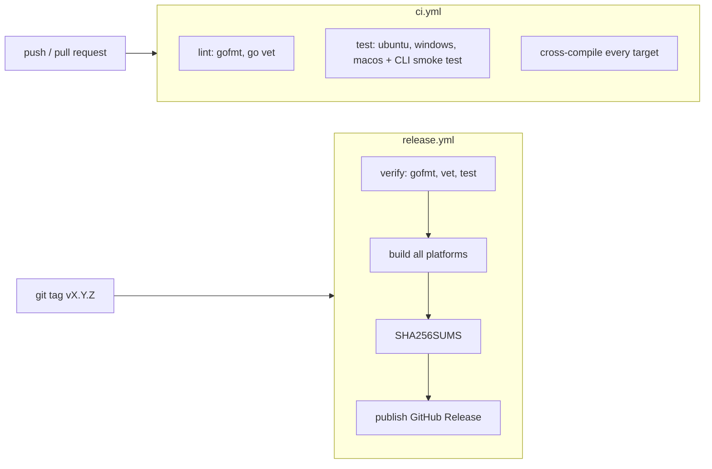

# logrecv-go

[](https://github.com/cumulus13/logrecv-go/actions/workflows/ci.yml)
[](https://github.com/cumulus13/logrecv-go/releases)
[](go.mod)
[](LICENSE)

A tiny, dependency-free **syslog / log receiver** for your terminal. It listens on UDP and/or TCP, understands
RFC 5424, RFC 3164 and plain lines (plus Laravel/Monolog-style `channel.LEVEL:` messages), and prints them as
colorful, aligned lines. Every color is a **hex code** you can change in a config file, and changes are applied
**live while it is running**.

- Single static binary, **zero third-party dependencies** (standard library only)
- UDP and TCP listeners, run either or both
- RFC 5424, RFC 3164, bare `<PRI>` and plain-text lines, Laravel/Monolog prefixes, JSON/dict payload highlighting
- Full **hex color** theming (`#RRGGBB` / `#RGB`), foreground and background, per level, per field
- **Hot reload**: edit the config while `logrecv` runs and colors change within ~0.5 s; a broken edit is ignored
- Truecolor with automatic fallback to 256 colors, respects `NO_COLOR` and disables colors when piped
- Safe output: control characters in incoming logs can't inject terminal escape sequences
- Level filter, text filter, and raw-line file tee
- Prebuilt binaries for Linux, Windows, macOS, the BSDs, Solaris/illumos, AIX and Plan 9

## Contents

- [How it works](#how-it-works)
- [Install](#install)
- [Quick start](#quick-start)
- [Usage](#usage)
- [Sending logs to it](#sending-logs-to-it)
- [Supported message formats](#supported-message-formats)
- [Colors and configuration](#colors-and-configuration)
- [Hot reload](#hot-reload)
- [Color modes](#color-modes)
- [Build from source](#build-from-source)
- [CI and releases](#ci-and-releases)
- [Supported platforms](#supported-platforms)
- [Troubleshooting](#troubleshooting)
- [License](#license)
- [Author](#-author)

## How it works



[](https://files.catbox.moe/3vc053.jpg)

## Install

### Prebuilt binaries

Download the archive for your platform from the [Releases](https://github.com/cumulus13/logrecv-go/releases)
page, verify it against `SHA256SUMS`, and put the `logrecv` binary somewhere on your `PATH`.

```sh
# Linux amd64 example
VERSION=v1.0.1
curl -LO https://github.com/cumulus13/logrecv-go/releases/download/$VERSION/logrecv_${VERSION}_linux_amd64.tar.gz
curl -LO https://github.com/cumulus13/logrecv-go/releases/download/$VERSION/SHA256SUMS
sha256sum --check --ignore-missing SHA256SUMS
tar xzf logrecv_${VERSION}_linux_amd64.tar.gz
sudo install logrecv_${VERSION}_linux_amd64/logrecv /usr/local/bin/
```

On Windows download the `.zip`, extract it, and run `logrecv.exe`.

> **macOS:** binaries are not notarized. If Gatekeeper blocks the download, run
> `xattr -d com.apple.quarantine ./logrecv` once.

### With Go

```sh
go install github.com/cumulus13/logrecv-go@latest
```

This installs a binary named `logrecv-go` (Go names it after the module). Rename or alias it to `logrecv` if you like.

## Quick start

```sh
logrecv init      # write the default config file (optional, defaults work without it)
logrecv show      # print effective config + a colored preview of every level
logrecv           # listen on UDP :5514 and print incoming logs
```

In another terminal:

```sh
logger -n 127.0.0.1 -P 5514 -d -p user.err -t myapp "something went wrong"
```

## Usage

```
logrecv [run] [flags]     start the receiver (default command)
logrecv init [-f]         write the default config file (-f overwrites)
logrecv show [-json]      show effective config and a color preview
logrecv path              print the config file path
logrecv version           print the version
logrecv help
```

### Run flags

| Flag | Default | Description |
|------|---------|-------------|
| `-udp ADDR` | `:5514` | UDP listen address. Empty string disables UDP. |
| `-tcp ADDR` | _(off)_ | TCP listen address, e.g. `:5514`. Lines are newline-delimited (max 1 MiB per line). |
| `-level LEVEL` | `debug` | Minimum level to show: `emerg`, `alert`, `crit`, `error` (`err`), `warn` (`warning`), `notice`, `info`, `debug`. |
| `-grep TEXT` | _(none)_ | Only show lines containing `TEXT` (case-insensitive). |
| `-file PATH` | _(none)_ | Also append the raw (uncolored) lines to `PATH`. |
| `-timefmt FMT` | `15:04:05.000` | [Go time layout](https://pkg.go.dev/time#pkg-constants) for the timestamp. |
| `-config PATH` | per-OS default | Config file to use. Also settable via `LOGRECV_CONFIG`. |
| `-color MODE` | `auto` | `auto`, `always`, `never` or `256`. See [Color modes](#color-modes). |

Informational messages (listening addresses, config reloads, warnings) go to **stderr**, so **stdout contains only
log lines** and is safe to pipe.

### Examples

```sh
logrecv -udp :514 -tcp :514                 # both transports on the standard syslog port (needs privileges)
logrecv -level warn                         # warnings and above only
logrecv -grep "payment" -file payments.log  # filter and keep a raw copy
logrecv -tcp :5514 -udp ""                  # TCP only
logrecv -color always | less -R             # keep colors when paging
```

## Sending logs to it

```sh
# util-linux logger over UDP
logger -n 127.0.0.1 -P 5514 -d -p user.warning -t myapp "disk almost full"

# raw datagram with netcat (RFC 5424: <PRI>VERSION TIMESTAMP HOST APP PID MSGID SD MSG)
echo '<11>1 2026-10-28T10:00:00Z web01 nginx 4242 - - upstream failed {"code":502}' | nc -u -w1 127.0.0.1 5514

# TCP, newline-delimited
printf '<14>Oct 28 10:00:00 db01 postgres[7]: ready\n' | nc -w1 127.0.0.1 5514
```

```python
# Python
import logging, logging.handlers
h = logging.handlers.SysLogHandler(address=("127.0.0.1", 5514))
logging.getLogger().addHandler(h)
logging.getLogger().error("hello from python")
```

```php
<?php // Laravel config/logging.php channel
'syslog_udp' => [
    'driver'  => 'monolog',
    'handler' => Monolog\Handler\SyslogUdpHandler::class,
    'handler_with' => ['host' => '127.0.0.1', 'port' => 5514],
],
```

```powershell
# PowerShell
$u = New-Object System.Net.Sockets.UdpClient
$b = [Text.Encoding]::UTF8.GetBytes('<11>1 2026-10-28T10:00:00Z win01 app 1 - - test message')
$u.Send($b, $b.Length, '127.0.0.1', 5514) | Out-Null
```

## Supported message formats

Each incoming line is matched in this order; the first match wins.



[](https://files.catbox.moe/c47fjw.jpg)

Notes:

- Severity is taken from the low 3 bits of the syslog `<PRI>` value (the facility is ignored).
- Multi-line UDP datagrams are split on `\n` and each line is handled separately.
- Trailing `\r`, `\n`, NUL bytes and a leading BOM are stripped.

| Severity | Label shown | Config key |
|---------:|-------------|------------|
| 0 | `EMERG` | `emergency` |
| 1 | `ALERT` | `alert` |
| 2 | `CRIT` | `critical` |
| 3 | `ERROR` | `error` |
| 4 | `WARN` | `warning` |
| 5 | `NOTICE` | `notice` |
| 6 | `INFO` | `info` |
| 7 | `DEBUG` | `debug` |

## Colors and configuration

### Where the config lives


[](https://files.catbox.moe/55sbnz.jpg)

Run `logrecv path` to print the exact path on your machine. A missing or empty file simply means "use the defaults".

### Config format

`config.json` is plain JSON (no comments). Any key you leave out keeps its default. Unknown keys are rejected so typos
are caught. Colors are `#RRGGBB` or `#RGB` (`#` optional).

```json
{
  "datetime": "#00AAFF",
  "host":     "#FFFFFF",
  "app":      "#00AAFF",
  "pid":      "#E8E8E8",
  "channel":  "#FFFFFF",
  "extra":    "#FFFFFF",
  "trace":    "#FFFFFF",
  "levels": {
    "emergency": { "level": { "fg": "#FFFFFF", "bg": "#AA00FF" }, "text": { "fg": "#FFFFFF", "bg": "#AA00FF" } },
    "alert":     { "level": { "fg": "#FFFFFF", "bg": "#0000FF" }, "text": { "fg": "#FFFFFF", "bg": "#0000FF" } },
    "critical":  { "level": { "fg": "#FFFFFF", "bg": "#005500" }, "text": { "fg": "#FFFFFF", "bg": "#005500" } },
    "error":     { "level": { "fg": "#FFFFFF", "bg": "#FF0000" }, "text": { "fg": "#FFFFFF", "bg": "#FF0000" } },
    "warning":   { "level": { "fg": "#000000", "bg": "#FFFF00" }, "text": { "fg": "#000000", "bg": "#FFFF00" } },
    "notice":    { "level": { "fg": "#000000", "bg": "#00FFFF" }, "text": { "fg": "#00FFFF" } },
    "info":      { "level": { "fg": "#000000", "bg": "#00FF00" }, "text": { "fg": "#00FF00" } },
    "debug":     { "level": { "fg": "#FFFFFF", "bg": "#FF5500" }, "text": { "fg": "#FFFFFF", "bg": "#FF5500" } }
  }
}
```

### What each key colors

| Key | Applies to |
|-----|------------|
| `datetime` | the timestamp |
| `host` | the sender host name or IP |
| `app` | the application / program name |
| `pid` | the process id, shown as `[1234]` |
| `channel` | the Laravel/Monolog channel prefix, shown as `[local]` |
| `extra` | trailing JSON / dict payload at the end of a message |
| `trace` | stack-trace lines (`#0 ...`, `[stacktrace]`, `{main}`) |
| `levels.<name>.level` | the level badge (e.g. ` ERROR `) |
| `levels.<name>.text` | the message text of that level |

For each `level` / `text` object, `fg` is the foreground and `bg` the background (either may be omitted). When you
override a `level` or `text` object it replaces the default object entirely, so include every field you want.

### Default palette

| Level | Badge (fg on bg) | Message (fg on bg) |
|-------|------------------|--------------------|
| EMERGENCY | `#FFFFFF` on `#AA00FF` | `#FFFFFF` on `#AA00FF` |
| ALERT | `#FFFFFF` on `#0000FF` | `#FFFFFF` on `#0000FF` |
| CRITICAL | `#FFFFFF` on `#005500` | `#FFFFFF` on `#005500` |
| ERROR | `#FFFFFF` on `#FF0000` | `#FFFFFF` on `#FF0000` |
| WARNING | `#000000` on `#FFFF00` | `#000000` on `#FFFF00` |
| NOTICE | `#000000` on `#00FFFF` | `#00FFFF` |
| INFO | `#000000` on `#00FF00` | `#00FF00` |
| DEBUG | `#FFFFFF` on `#FF5500` | `#FFFFFF` on `#FF5500` |

Datetime and app are `#00AAFF`, pid is `#E8E8E8`, and JSON/dict payloads, hosts, channels and traces are `#FFFFFF`.

### Config commands

```sh
logrecv init          # create the config with the defaults (refuses to overwrite)
logrecv init -f       # overwrite an existing config
logrecv path          # print the config path
logrecv show          # path, effective config and a colored preview of all levels
logrecv show -json    # only the effective config as JSON (good for scripts)
```

## Hot reload

The running receiver watches the config file. Save a change and the new colors apply to the very next line, no
restart needed. If the edit is invalid (bad hex, unknown key, broken JSON) the previous colors stay active and a
warning is printed to stderr. Deleting the file switches back to the defaults.



[](https://files.catbox.moe/uvt0gx.jpg)

The file is polled rather than watched with OS notifications, which keeps the program dependency-free and behaving
the same on every platform.

## Color modes

`-color auto` (the default) picks the best mode for your terminal:



[](https://files.catbox.moe/frfbth.jpg)

Force a mode with `-color always` (truecolor), `-color 256` or `-color never`. Use `always` when you want colors in
a pipe, or in terminals such as Git Bash/mintty that don't look like a console to Go.

## Build from source

Requires Go 1.25 or newer.

```sh
git clone https://github.com/cumulus13/logrecv-go
cd logrecv-go
go build -trimpath -ldflags "-s -w -X main.version=1.0.1" -o logrecv .
go test ./...
```

Cross-compile every release target with the same script CI uses:

```sh
bash .github/scripts/build-release.sh v1.0.1 dist
```

Project layout:

```
main.go                entry point, commands, listeners, log parsing and rendering
config.go              config schema, defaults, loading, theme compilation, hot-reload store
color.go               hex parsing, truecolor/256 ANSI, color mode detection
console_windows.go     enables ANSI/VT processing on the Windows console
console_other.go       no-op for other platforms
main_test.go           unit tests
.github/targets.txt    release platform list
.github/scripts/       release build script
.github/workflows/     CI and release pipelines
```

## CI and releases



[](https://files.catbox.moe/k1thtb.jpg)

To cut a release:

```sh
git tag v1.0.2
git push origin v1.0.2
```

Tags that contain a hyphen (for example `v1.1.0-rc.1`) are published as pre-releases.

## Supported platforms

Release archives are produced for these targets (static binaries, `CGO_ENABLED=0`). Windows builds are `.zip`,
everything else `.tar.gz`.

| OS | Architectures |
|----|---------------|
| Linux | amd64, 386, arm64, armv6, armv7, riscv64, loong64, ppc64, ppc64le, s390x, mips / mipsle / mips64 / mips64le (hardfloat and softfloat) |
| Windows | amd64, 386, arm64 |
| macOS | amd64 (Intel), arm64 (Apple Silicon) |
| FreeBSD | amd64, 386, arm64, armv7 |
| OpenBSD | amd64, 386, arm64, armv7, ppc64, riscv64 |
| NetBSD | amd64, 386, arm64, armv7 |
| DragonFly BSD | amd64 |
| Solaris / illumos | amd64 |
| AIX | ppc64 |
| Plan 9 | 386, amd64, arm |

## Troubleshooting

- **`udp: listen ... address already in use`**: another process uses that port. Pick another with `-udp :5515`, or stop the other one.
- **Ports below 1024 (e.g. 514) fail with a permission error**: run with sufficient privileges or use a high port and point your senders at it.
- **No colors in a pipe or in Git Bash**: this is intentional in `auto` mode; use `-color always`.
- **Colors look wrong or washed out**: your terminal may not support truecolor. Try `-color 256`.
- **Config edits don't seem to apply**: check stderr for `config reload failed`; run `logrecv show` to see the exact error.
- **Windows console shows escape codes literally**: use Windows Terminal or Windows 10+ console; `logrecv` enables VT processing automatically.
- **Nothing shows up**: check the sender's target port/protocol, any `-level` / `-grep` filter, and your firewall (UDP is silent when dropped).

## License

[MIT](LICENSE) © Hadi Cahyadi

## 👤 Author
        
[Hadi Cahyadi](mailto:cumulus13@gmail.com)
    

[](https://www.buymeacoffee.com/cumulus13)

[](https://ko-fi.com/cumulus13)
 
[Support me on Patreon](https://www.patreon.com/cumulus13)
